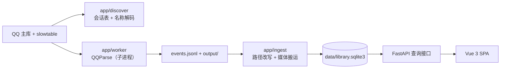

# Web 版（app/ + web/）

后端把 QQ 数据库解析成 `ChatDocument`（`data/library.sqlite3`），前端只做查询和渲染。
解析沿用 `src/dataParsing` 的现有实现，在子进程中运行，不修改原始数据库。

## 启动

```bash
# 首次：同步依赖（uv 按 pyproject.toml/uv.lock 管理 .venv）
uv sync

# 启动服务（在仓库根目录执行）
uv run qqhe --open
# 自定义监听地址
uv run qqhe --host 127.0.0.1 --port 8000
```

`uv run qqhe` 会自动对比 `web/src` 与 `web/dist` 的构建清单，源码有变化时先
`npm run build` 再启动，因此不需要手动构建；找不到 npm 时会报错退出，
避免服务端跑旧前端。

`uv run qqhe` 等价于 `uv run python -m app serve`；`uv sync` 会把本项目以可编辑方式装进 `.venv`，
`qqhe` 命令由 `pyproject.toml` 的 `[project.scripts]` 提供。

首次打开会要求填写：

- 主库 `QQ号.db`、可选 `slowtable_QQ号.db`（只读）
- `kc` 文件或直接填密钥
- 媒体目录（可选；给 `Tencent/MobileQQ` 的上级目录即可自动推导）

保存后点侧栏的 ⟳ 手动扫描会话列表。点击任意会话首次会自动加载（后台作业，SSE 显示进度），
加载完成后直接按日期、成员浏览：日期只负责定位，不再限制显示范围，导出也与当前显示窗口无关。
点「选择」进入勾选模式，可跨日期跳转逐条勾选；先勾一条作为起点，跳到别处后点「选中到当前」
即可选中整段，也支持 Shift 点击连续选择。导出时只导出勾选的消息，未进入选择模式则导出整个会话。
adb 数据源下聊天页有「刷新」用于重新读取；删除操作已移除，
本地数据被视为可从数据源重建的缓存。

### 直接用 adb 在线读取

数据库路径填 `adb:` 前缀即可，不需要先把整份数据库拉到电脑：

```
adb:/data/user/0/com.tencent.mobileqq/databases/QQ号.db
adb:/data/user/0/com.tencent.mobileqq/databases/slowtable_QQ号.db
```

`kc` 也可以填 `adb:/data/data/com.tencent.mobileqq/files/kc`。设备需要有 root 和
sqlite3（默认用 Termux 的 `/data/data/com.termux/files/usr/bin/sqlite3`，可在设置里改）。

工作方式：

- 会话发现只在点击「扫描」时执行，服务端不缓存；直接 `sqlite3 -readonly` 查询设备上的数据库
  （实测 549 个会话、400 万条消息约 3 秒）；
- 导入（点击「导入」）时只读 ATTACH 在线数据库，把「所选会话表 + Friends/TroopInfoV2/TroopMemberInfo」
  导出到设备 `/tmp`（tmpfs），再拉回本机系统临时目录；导入结束（无论成功失败）两边的临时文件都会删除；
- 不生成整库快照，不写设备存储（`/tmp` 是内存盘），也不在仓库 `data/` 下保留中间数据库；
- adb 模式下图片不会在导入时批量拉取：解析器只写 `lazy:<md5>` 引用，浏览到某张图时
  由 `/lazy/{会话}/{md5}` 按需从设备 `chatpic/chatimg` 拉取单个文件，缓存到
  `data/media_cache/`（同一 md5 加锁去重，失败负缓存 5 分钟）。设备缓存里已被清理的图片
  显示「图片不可用」；语音/视频仍未接入。
- 头像不受影响，按需从 qlogo 联网拉取并缓存到 `data/avatars/`（设置里可关闭）。

## 数据流



## 目录

```
app/
  main.py       FastAPI 路由、SSE、静态托管
  discover.py   只读扫描主库/慢表，列出会话和条数
  worker.py     导入作业进程（调用现有解析器）
  ingest.py     chatData.txt -> ChatDocument，媒体落到 data/media/<会话>/
  store.py      library.sqlite3 的 schema 与查询
  jobs.py       串行作业管理、事件流、取消
web/src/        Vue 3 + TypeScript 单页应用
data/           运行时数据（已 gitignore）
```

## 接口

| 方法 | 路径 | 说明 |
|---|---|---|
| GET | `/api/state` | 配置视图、已加载会话、当前作业 |
| POST | `/api/setup` | 保存数据库/密钥/媒体路径（不自动扫描） |
| GET | `/api/discover` | 会话列表（每次重新读取，不缓存） |
| POST | `/api/import` | 首次加载 / 刷新会话（后台作业） |
| GET | `/api/jobs/{id}` | 作业状态 |
| GET | `/api/jobs/{id}/events` | SSE 事件流 |
| GET | `/api/conversations/{key}/messages` | 游标分页 + 成员过滤 |
| GET | `/api/conversations/{key}/ids` | 时间区间内的消息 ID（区间勾选） |
| GET | `/api/conversations/{key}/senders` | 成员列表与条数 |
| GET | `/api/conversations/{key}/days` | 每日消息数（日期索引） |
| POST | `/api/save-path` | 弹出系统另存为对话框，返回完整保存路径 |
| POST | `/api/export` | 按整个会话或勾选的 `ids` 导出，`target` 为保存路径 |
| GET | `/api/export/{id}` | 导出任务状态 |
| GET | `/media/{会话}/{路径}` | 媒体文件（StaticFiles，支持 Range） |

## 当前限制

- 同时只允许一个加载/刷新作业（SQLite 单写者，解析也是 CPU 密集）。
- 现有解析器会把整张会话表读入内存后排序；百万级会话需要最终改成流式归并。
- PDF/HTML/Markdown 导出在 `app/export.py`，PDF 复用 reportlab 排版器；消息浏览走 Web 分页。
- adb 模式图片按需从设备缓存回源（只覆盖仍存在的缓存文件），语音/视频暂未接入。
- 桌面入口统一为 `uv run qqhe`（Web UI），旧的 PyQt5 GUI 已移除。
